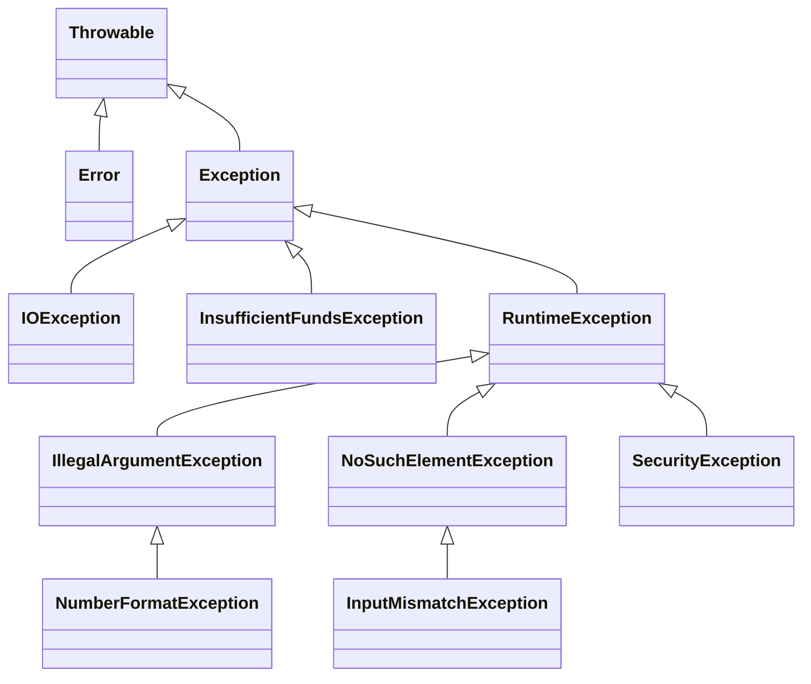

# Q1 ATM failure handling

## Aim

Classify withdrawal failures and validate catch selection and finally execution.

## Design and analysis

Eight inputs cover a valid withdrawal, a nonnumeric account, nonnumeric amount, negative amount, insufficient funds, missing card file, mismatched account and NaN. The balance is a simulation constant of 1000, not a bank integration. Inputs are retained in inputs/cases.csv.

Throwable branches into Error and Exception. Error represents VM/linkage/resource failures that this ATM does not normally recover from. Checked IOException (including NoSuchFileException) and checked InsufficientFundsException represent recoverable external/business failures. RuntimeException includes NumberFormatException, InputMismatchException, IllegalArgumentException and SecurityException. No real VM Error is deliberately triggered.

Catch order: numeric parsing multi-catch precedes IllegalArgumentException because NumberFormatException is its subclass. Security, funds and I/O catches distinguish other recovery paths. A broad IOException before FileNotFoundException is unreachable; inputs/CatchOrder.java.txt is deliberately invalid and its compiler diagnostic is retained separately. It is not part of the normal successful build.

The try-with-resources Scanner and reader close on normal and exceptional paths. The finally message runs on each ordinary completion or propagation path; it cannot guarantee execution after JVM halt, forced process termination or a machine failure. The eight observed messages are counted by the runner.

UncaughtTrace intentionally exits nonzero. In its trace, the first line names NumberFormatException and its message; java.base frames show numeric parsing internals. The application frames identify parseAccount, service and main, with source line numbers, read from the throw site outward. The intentionally uncaught run is expected evidence, not a failed assignment check.

A single catch(Exception) can be appropriate at a top-level boundary that logs the full cause and produces a controlled response, but it loses exception-specific handling unless the types are subsequently distinguished. It does not catch Error and should not silently convert programming defects into success.

The validateWithoutThrowing alternative uses hasNextLong/hasNextDouble and explicit result codes for expected input errors. It still needs a way to handle actual I/O failure, since pre-checking file existence cannot eliminate races. Ordinary checks and result codes need O(1) auxiliary state per attempt; parsing is O(input length). Constructing a throwable with a captured depth-d trace normally requires O(d) trace work/storage, while returning a code is O(1). Chaining retains additional causes and their traces.

## Run

```bash
python tools/run.py Q1
```

Run from the repository root. On Windows, `py` can replace `python`. Java 17+ JDK and Python 3 are required. Both supplied before/after programs are built into isolated directories.

## Executed results

```text
ATM paths=8; finally markers=8
PASS: eight failure/success paths; finally runs for every attempt
UncaughtTrace exited nonzero with NumberFormatException (expected)
Broad-before-narrow catch rejected by Java compiler (expected)
```


## Throwable hierarchy



The full exception classes, failures and actual selected catches appear in the source and outputs.

## Evidence files

- `results/execution.txt`: full stdout/stderr from real execution.
- `results/checks.txt`: compact outcome summary.
- `results/environment.json`: actual JVM, execution origin and parameters.
- `screenshots/compiler.jpg` and `screenshots/output.jpg`: real terminal captures.
- Task-specific CSV files and stack/debugger traces are retained where applicable.

Execution took place in the workspace, not on the student device. Each student must personally rerun and understand every task. Individual pair-work contributions are not invented.
