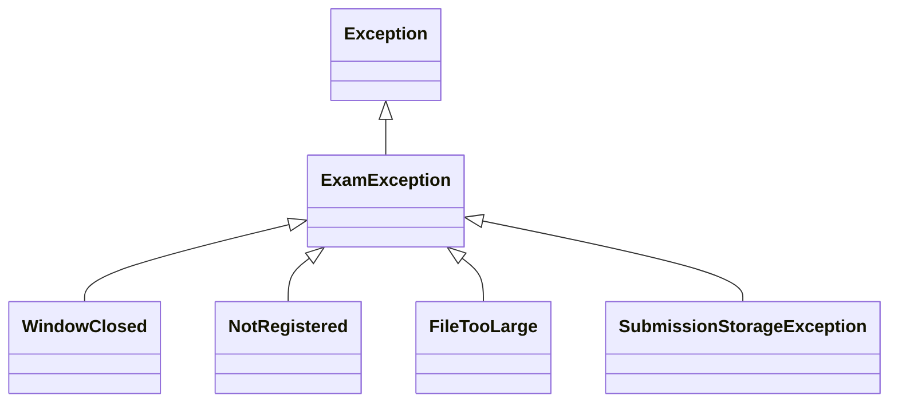

# Q2 Exam exceptions and propagation

## Aim

Implement checked domain exceptions across controller, service and storage layers while preserving causes.

## Design and analysis

ExamPortal uses checked ExamException subclasses WindowClosed, NotRegistered, FileTooLarge and SubmissionStorageException. These are expected failures a caller can present or recover from. Negative size metadata is an unchecked IllegalArgumentException because it violates the API contract. Java still requires the checked declaration on main for its direct service test, even though that chosen input throws the unchecked exception first.

Propagation: Files.readAllBytes -> IOException -> storage wraps it as SubmissionStorageException(message,cause) -> service declares throws ExamException -> controller catches ExamException, displays a domain message and records the full chain. The program is a storage-access simulation: it validates readability of the supplied answer fixture rather than claiming to upload to a production portal.

The five designed cases cover success and every checked subclass. The supplied StorageDemo has only its TODO body completed and must produce Saved answer01.pdf / Error: Could not store answer02.pdf / Cause: Disk quota exceeded.

If the cause is omitted, getCause() returns null. The supplied expression e.getCause().getMessage() then throws NullPointerException; it does not safely print a Cause message. ExamPortal demonstrates both the lost cause and this dereference failure.

Meaningful storage exceptions isolate implementation details from the UI, while a preserved IOException cause supports diagnosis. Extending RuntimeException would remove mandatory catch/throws declarations, but not the need for intentional boundary handling. Trace capture costs O(d) time/storage for depth d; a chain retains each cause and its trace, roughly O(sum of trace depths), rather than copying an entire trace into every wrapper.

## Run

```bash
python tools/run.py Q2
```

Run from the repository root. On Windows, `py` can replace `python`. Java 17+ JDK and Python 3 are required. Both supplied before/after programs are built into isolated directories.

## Executed results

```text
StorageDemo: Saved answer01.pdf | Error: Could not store answer02.pdf | Cause: Disk quota exceeded
PASS: portal rules, layered propagation and cause preservation
```


## Exception hierarchy and propagation



Storage IOException -> SubmissionStorageException with cause -> service throws ExamException -> controller catches and displays domain message.

## Evidence files

- `results/execution.txt`: full stdout/stderr from real execution.
- `results/checks.txt`: compact outcome summary.
- `results/environment.json`: actual JVM, execution origin and parameters.
- `screenshots/compiler.jpg` and `screenshots/output.jpg`: real terminal captures.
- Task-specific CSV files and stack/debugger traces are retained where applicable.

Execution took place in the workspace, not on the student device. Each student must personally rerun and understand every task. Individual pair-work contributions are not invented.
