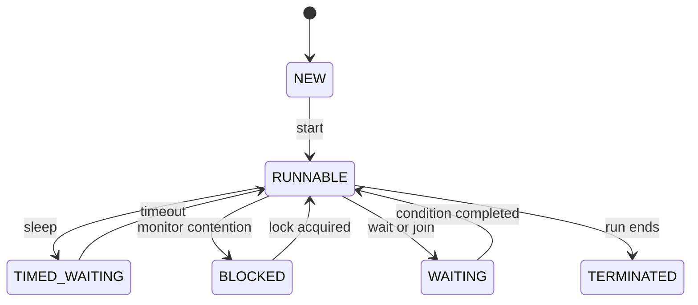

# Q4 Threads and lifecycle

## Aim

Implement scanner batches with Thread and Runnable and record scheduling behaviour over repeated runs.

## Design and analysis

ScannerStations records ten Thread trials, ten Runnable trials and ten priority trials, each with four stations and final total 100. Each station simulates one 25-script batch using a short sleep. These are scheduler demonstrations, not measurements of real scanner throughput. The exact completion orders are in station_orders.csv; variation is permitted but not guaranteed in ten runs.

Extending Thread couples the task to a thread class and consumes Java's single superclass choice. Runnable separates a task from execution and is normally easier to reuse with executors. start schedules a new thread; invoking run directly is an ordinary call on main. The direct-run evidence retains state NEW and isAlive=false.

Lifecycle: NEW -> RUNNABLE -> TIMED_WAITING during sleep -> RUNNABLE -> TERMINATED. BLOCKED can occur while acquiring an intrinsic lock; WAITING can occur during untimed join/wait. These latter states are relevant to the lifecycle but are not claimed to have been observed for every scanner. The captured state test prints NEW, a sampled TIMED_WAITING and TERMINATED. RUNNABLE includes running or eligible-to-run states.

join ensures each station has terminated before its result is read and provides the required visibility relationship. sleep does not release an intrinsic monitor. Priorities are scheduler hints, not a portable finish-order guarantee. DaemonDemo runs in separate JVMs: the daemon worker starts but its delayed WORK_DONE is absent when main ends; a non-daemon worker keeps the JVM alive until WORK_DONE.

The fixed four-thread ExecutorService alternative sums four Callable results through Future.get and shuts down explicitly. For total work n and p workers, ideal balanced useful work is O(n/p), plus launch/scheduling and longest-batch overhead; creating more workers than available parallel work cannot make that bound unconditional. Thread stacks use roughly O(p * stack size); a pool can reuse p threads over many batches.

## Run

```bash
python tools/run.py Q4
```

Run from the repository root. On Windows, `py` can replace `python`. Java 17+ JDK and Python 3 are required. Both supplied before/after programs are built into isolated directories.

## Executed results

```text
DIRECT_RUN: [direct@main]; thread state=NEW; alive=false
STATE before start=NEW
STATE after start=TIMED_WAITING; alive=true
STATE after join=TERMINATED; alive=false
EXECUTOR total=100
PASS: 30 ordering trials, run/start distinction, lifecycle and executor totals
Station completion orders recorded: 10 Thread + 10 Runnable + 10 priority trials
DaemonDemo_true: WORKER_STARTED daemon=true | MAIN_END without join
DaemonDemo_false: WORKER_STARTED daemon=false | MAIN_END without join | WORK_DONE
```


## Lifecycle



## Evidence files

- `results/execution.txt`: full stdout/stderr from real execution.
- `results/checks.txt`: compact outcome summary.
- `results/environment.json`: actual JVM, execution origin and parameters.
- `screenshots/compiler.jpg` and `screenshots/output.jpg`: real terminal captures.
- Task-specific CSV files and stack/debugger traces are retained where applicable.

Execution took place in the workspace, not on the student device. Each student must personally rerun and understand every task. Individual pair-work contributions are not invented.
