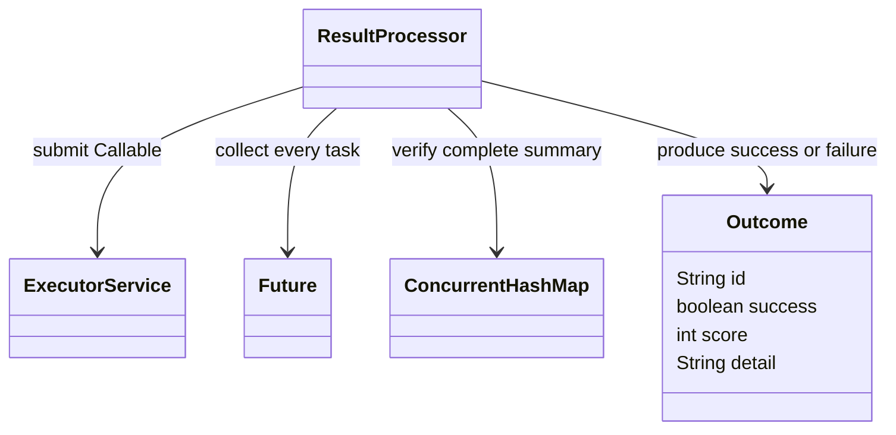

# Q7 Concurrent fault-tolerant result processing

## Aim

Process 10,000 real score files with isolated failures and compare pools of 1, 2, 4 and 8.

## Design and analysis

Requirements: read and validate each independent score file, retain exactly one result per unique file identity, do not let an ordinary corrupt/missing file abort other jobs, and produce success/failure counts summing to 10,000. Correctness targets are 9,700 successful reads and 300 injected processing failures. A valid low score is FAIL_GRADE, which is a successfully processed result, not a file-processing failure.

ResultProcessor uses ExecutorService, explicit Callable<Outcome>, Future and ConcurrentHashMap<String,Outcome>. Each job handles IOException/ScoreException locally. The collector calls get on every Future, handles unexpected task exceptions and verifies the result map has the same size as the input set before summary. Serious Error causes are propagated, not silently classified as ordinary bad files. Duplicate identities are rejected before submission. Interruptions abort normal completion rather than producing a misleading complete summary.

The hand-checked set has five requests: valid 80, valid 0, corrupt text, out-of-range 101 and missing file, giving two successes and three failures. The large dataset is generated by documented rules: each index ending in 00 is missing, 01 corrupt and 02 out of range. Other scores are index modulo 101. The repository includes the generator, specification and hand fixtures; generated/ is excluded because it is reproducible. All 10,000 canonical outcomes are recorded in results/outcomes.csv.

Each pool has one warmup and five measured runs over the same generated files. Data generation is outside timing. Measurements include pool creation, submission, reads, validation, task joins, shutdown and result-map completeness checking. Summary aggregation and CSV output are outside timing. Trials reuse OS filesystem caches and have fixed pool order, so results are not cold-storage measurements or a universal scaling claim.

Choose the lowest measured five-run mean for this environment and rerun on the deployment hardware. Extra threads can help with I/O waits but add scheduling, synchronization, allocation and storage contention; CPU and filesystem limits matter. One limitation is O(n) queued tasks, Futures and outcomes. A bounded submission window or completion queue would reduce the outstanding-task memory for much larger datasets. Input content length should also be capped in a hardened deployment.

For n files, total data bytes B, p workers and longest task tmax, ideal useful-work time is at least max(B-throughput cost divided across available parallelism, tmax), plus scheduling/collection overhead. Map/Future/queue metadata is O(n), input processing buffers are per active worker, and thread-stack storage is O(p * stack size). Parallel streams can use the same per-file catch-and-return wrapper but use a shared common pool by default; unchecked exceptions escaping a lambda can abort collection. One thread per file can consume O(n * stack size) and exhaust thread resources; exceptions must still be captured and every worker joined to count outcomes reliably.

## Run

```bash
python tools/run.py Q7
```

Run from the repository root. On Windows, `py` can replace `python`. Java 17+ JDK and Python 3 are required. Both supplied before/after programs are built into isolated directories.

## Executed results

```text
HAND_CHECK total=5,success=2,failure=3
RECOMMEND_FOR_THIS_RUN pool=8; based on lowest five-run mean, not a universal optimum
PASS: all pools complete 10000 files; 9700 successes and 300 isolated failures; hand set verified
```

## Measured evidence

| pool | Mean batch ms | Sample CV |
|---|---:|---:|
| 1 | 169.1618 | 3.5% |
| 2 | 61.4942 | 12.1% |
| 4 | 37.0382 | 11.8% |
| 8 | 23.5577 | 15.7% |

CV is sample standard deviation divided by mean. Compare all raw runs; high variation weakens small speed differences. These are classroom experiments, not JMH measurements.

## Design representation



```text
validate unique file identities
create a fixed thread pool and concurrent result map
for each file submit a Callable
    try read and validate using try-with-resources
    catch expected file errors and create a failed Outcome
    publish Outcome under its unique identity
for every Future collect completion or record unexpected ordinary failure
shut down and await worker termination
assert outcome count equals requested file count
count successes and failures; persist canonical outcomes
```

## Evidence files

- `results/execution.txt`: full stdout/stderr from real execution.
- `results/checks.txt`: compact outcome summary.
- `results/environment.json`: actual JVM, execution origin and parameters.
- `screenshots/compiler.jpg` and `screenshots/output.jpg`: real terminal captures.
- Task-specific CSV files and stack/debugger traces are retained where applicable.

Execution took place in the workspace, not on the student device. Each student must personally rerun and understand every task. Individual pair-work contributions are not invented.
